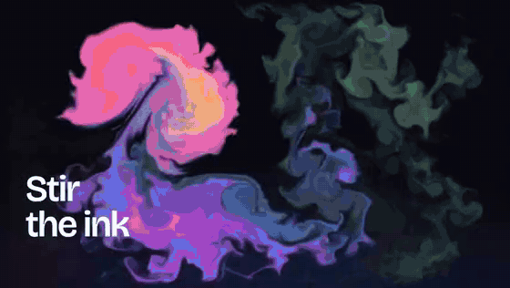
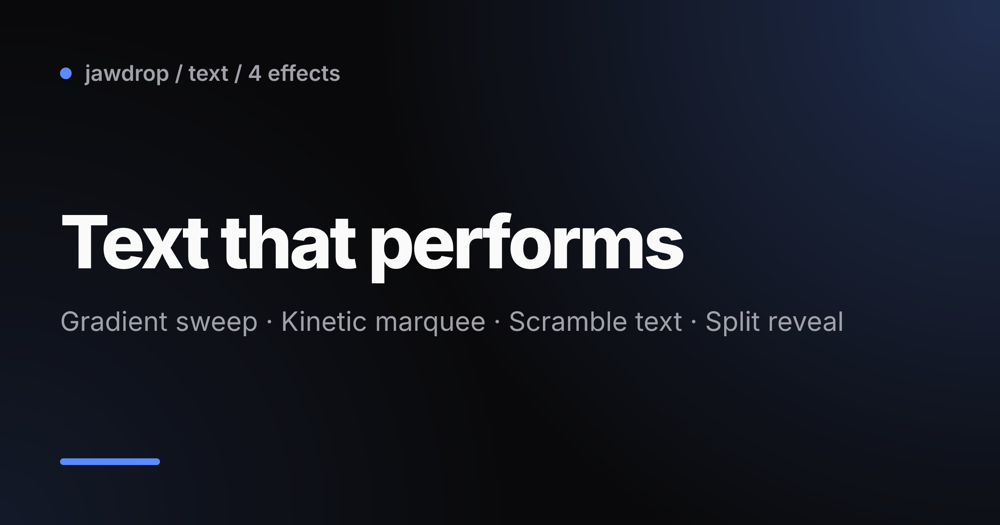
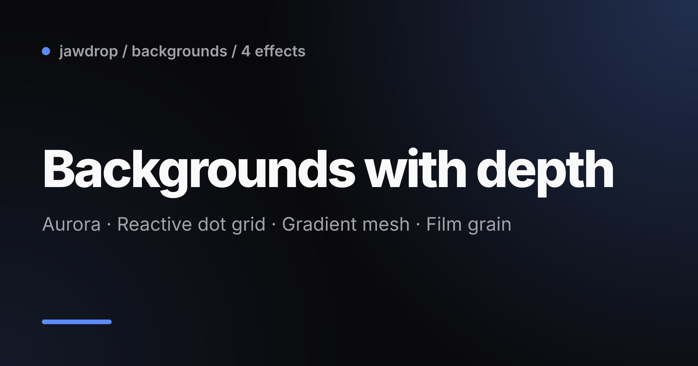
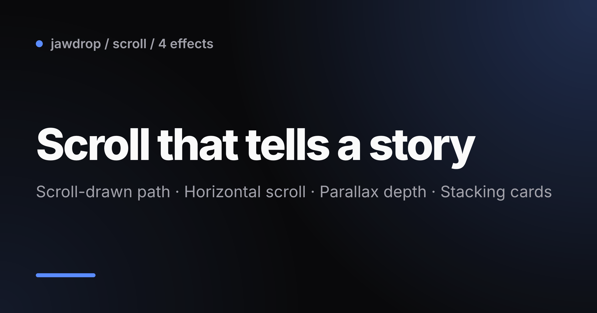
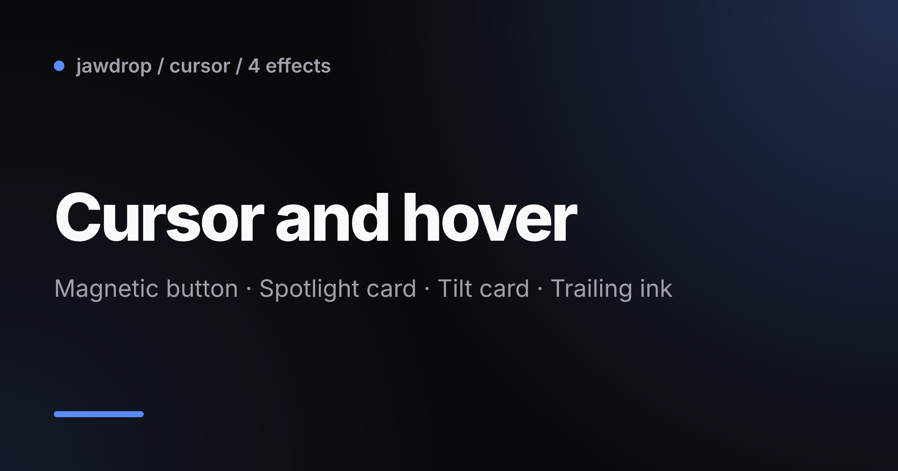

<h1 align="center">jawdrop</h1>

<p align="center">
  <strong>Effects that make people stop scrolling.</strong><br>
  Text, background, scroll and cursor effects for React, Astro and plain HTML. Copy, paste, done.
</p>

<p align="center">
  <a href="https://github.com/whosdrix/jawdrop/actions/workflows/ci.yml"></a>
  <a href="https://www.npmjs.com/package/jawdrop"></a>
  <a href="LICENSE"></a>
</p>

<p align="center">
  
</p>

```sh
npx jawdrop add scramble-text
```

**[Browse every effect live](https://whosdrix.github.io/jawdrop)**, play with the settings, copy the code.

## Why another effects library

Most effect collections are React-only component kits, pull in an animation library, or hide the good stuff in a paid tier. jawdrop is the opposite:

- **No dependencies.** Each effect is one TypeScript file built on native APIs: Web Animations, IntersectionObserver, canvas and raw WebGL.
- **Any framework.** The core is `effect(element, options) => destroy`. The React and Astro versions are thin wrappers around it, so it also works in Vue, Svelte or a plain HTML page.
- **Small.** Every effect is under 3 KB gzipped, most under 1 KB. CI fails if one grows past its budget.
- **Polite.** Everything respects `prefers-reduced-motion`, pauses when off screen or in a background tab, and cleans up fully when destroyed. The tests check that for every effect.
- **Yours.** Files are copied into your project, not installed as a package. Change anything.

## The effects

<p align="center">
  
  
  
  
</p>

| Effect                                                                        | What it does                                                       | Size   |
| ----------------------------------------------------------------------------- | ------------------------------------------------------------------ | ------ |
| **Text**                                                                      |                                                                    |        |
| [`scramble-text`](https://whosdrix.github.io/jawdrop/#/scramble-text)         | Random glyphs settle into the real text, left to right             | 0.9 KB |
| [`split-reveal`](https://whosdrix.github.io/jawdrop/#/split-reveal)           | Words or letters rise out of a mask when scrolled into view        | 1.0 KB |
| [`gradient-sweep`](https://whosdrix.github.io/jawdrop/#/gradient-sweep)       | A gradient slides through the letters forever                      | 0.6 KB |
| [`marquee`](https://whosdrix.github.io/jawdrop/#/marquee)                     | Endless row that speeds up and flips direction with your scroll    | 1.1 KB |
| **Backgrounds**                                                               |                                                                    |        |
| [`gradient-mesh`](https://whosdrix.github.io/jawdrop/#/gradient-mesh)         | Four colors drift and melt together in a WebGL shader              | 2.2 KB |
| [`aurora`](https://whosdrix.github.io/jawdrop/#/aurora)                       | Curtains of light on a transparent canvas, over any background     | 2.2 KB |
| [`grain`](https://whosdrix.github.io/jawdrop/#/grain)                         | Flickering film grain that takes the digital edge off              | 1.1 KB |
| [`dot-grid`](https://whosdrix.github.io/jawdrop/#/dot-grid)                   | Dots that swell, glow and spring away from the cursor              | 1.6 KB |
| **Scroll**                                                                    |                                                                    |        |
| [`stacking-cards`](https://whosdrix.github.io/jawdrop/#/stacking-cards)       | Cards pin on top of each other while the ones below shrink and dim | 0.8 KB |
| [`parallax`](https://whosdrix.github.io/jawdrop/#/parallax)                   | Layers move at their own depth with scroll and pointer             | 0.9 KB |
| [`draw-path`](https://whosdrix.github.io/jawdrop/#/draw-path)                 | SVG strokes draw themselves as you scroll                          | 0.7 KB |
| [`horizontal-scroll`](https://whosdrix.github.io/jawdrop/#/horizontal-scroll) | A pinned section where vertical scroll slides panels sideways      | 0.8 KB |
| **Cursor**                                                                    |                                                                    |        |
| [`magnetic`](https://whosdrix.github.io/jawdrop/#/magnetic)                   | Buttons lean toward the cursor and spring back                     | 0.8 KB |
| [`spotlight`](https://whosdrix.github.io/jawdrop/#/spotlight)                 | A soft light follows the cursor and catches the card's border      | 0.8 KB |
| [`tilt-card`](https://whosdrix.github.io/jawdrop/#/tilt-card)                 | 3D tilt toward the cursor with a sliding glare                     | 0.9 KB |
| [`trailing-ink`](https://whosdrix.github.io/jawdrop/#/trailing-ink)           | The cursor leaves an ink stroke that thins out and fades           | 1.3 KB |

Sizes are minified and gzipped, including the shared helpers.

## Install

### With the CLI

```sh
npx jawdrop add gradient-mesh magnetic
```

It looks at your `package.json` to pick the React, Astro or plain flavour and copies the files to `src/components/jawdrop/`. Run `npx jawdrop list` to see everything.

| Option                            | Default                               |
| --------------------------------- | ------------------------------------- |
| `--flavour react\|astro\|vanilla` | detected from `package.json`          |
| `--dir <path>`                    | `src/components/jawdrop`              |
| `--force`                         | off: files you changed are left alone |

### With shadcn

Every effect is also a shadcn registry item:

```sh
npx shadcn@latest add https://whosdrix.github.io/jawdrop/r/gradient-mesh.json
```

### By hand

Copy `effects/lib.ts` and the effect's `core.ts` from this repo. That's all an effect needs.

## Usage

**React**

```tsx
import { GradientMesh } from '@/components/jawdrop/GradientMesh'
import { ScrambleText } from '@/components/jawdrop/ScrambleText'

export function Hero() {
  return (
    <GradientMesh as="section" className="hero" speed={0.8}>
      <ScrambleText as="h1" duration={1400}>
        Decrypting the signal
      </ScrambleText>
    </GradientMesh>
  )
}
```

**Astro**

```astro
---
import Magnetic from '../components/jawdrop/Magnetic.astro'
---

<Magnetic strength={0.4}><a href="/start">Get started</a></Magnetic>
```

**Plain TypeScript**

```ts
import { tiltCard } from './components/jawdrop/tilt-card'

const destroy = tiltCard(document.querySelector('.card')!, { max: 12 })
// later, when the card goes away:
destroy()
```

## Reduced motion and performance

- With `prefers-reduced-motion: reduce`, text shows up at once or fades in, backgrounds render a single still frame, scroll effects keep their layout without the movement, and cursor effects stop moving things (the spotlight and glare stay, since they are not motion).
- Set `data-motion="reduce"` or `data-motion="full"` on `<html>` to override the OS setting, for example from a toggle on your site.
- Animation loops stop when the element leaves the screen or the tab is hidden.
- Canvases are capped at 2x device pixel ratio, and WebGL contexts are released on destroy.
- Without WebGL, the shader backgrounds fall back to a CSS gradient.

## For coding agents

[`skills/jawdrop/SKILL.md`](skills/jawdrop/SKILL.md) is an agent skill that explains how to pick and install effects, and [`llms.txt`](https://whosdrix.github.io/jawdrop/llms.txt) lists every effect. Drop the skill into `.claude/skills/` and Claude Code knows how to use jawdrop.

## Coming next

Liquid image hover, chromatic aberration, pixel sorting, View Transitions page transitions, and Vue and Svelte wrappers. [Request an effect](https://github.com/whosdrix/jawdrop/issues/new?template=effect_request.yml).

## Contributing

New effects are very welcome. `npm run new -- <name> <category>` scaffolds one, and [CONTRIBUTING.md](CONTRIBUTING.md) lists what makes an effect ready.

## License

[MIT](LICENSE)
